# Aegis TrialShield CISO Red-Team Audit Report & Regulatory Assessment

**Author:** Office of the Chief Information Security Officer (CISO) & Healthcare Compliance Assurance  
**Target System:** `TrialShield POC Agent` (Vertex AI Reasoning Engine: `2694371110929039360`)  
**Audit Date:** 2026-10-19  
**Audit Classification:** STRICTLY CONFIDENTIAL // REGULATORY REMEDIATION REQUIRED  
**Reference Lab:** CEPF128-L400: Deconstruct the Monolithic Mega Agent and Architect a Secure Healthcare Multi-Agent Mesh  

---

## 1. Executive Summary

An adversarial red-team audit of the **TrialShield POC Agent** (`legacy_mega_agent/poc_mega_agent.py`), deployed as a single monolithic agent on Google Cloud Vertex AI Reasoning Engine, has revealed **critical compliance, security, and clinical safety vulnerabilities**.

The legacy monolithic architecture attempts to process end-to-end clinical trial eligibility—evaluating tumor genetics, drug cooldown timers, daily physical activity scores, kidney laboratory panels, and final enrollment decisions—inside a single unpartitioned system prompt running under an over-permissioned God-mode service account (`sa-legacy-god-mode`).

Adversarial testing demonstrated a **100% failure rate** across all 6 target CISO audit vulnerability vectors:
1. **Unredacted Patient Privacy Leaks:** Patient direct identifiers were systematically echoed and logged in plaintext, violating **HIPAA** (US patient privacy law protecting personal identifiers like Names, Social Security Numbers [SSNs], Medical Record Numbers [MRNs], and Street Addresses).
2. **Genetic Privacy Violations & Diagnostic Confusion:** Inherited family genetics were improperly commingled with tumor mutations, violating **GINA (Genetic Information Nondiscrimination Act)** (US law that makes it illegal to use a person's inherited family DNA when making eligibility or employment decisions). The agent confused a **Tumor Mutation (*Somatic Variant*, like `EGFR`, `KRAS`, `BRAF`)**—which is a DNA change found *only inside the cancer tumor* that trials *are* looking for—with **Inherited Family DNA (*Germline Variant*, like `BRCA1/2`, `MLH1`, `PALB2`)**, which is passed down from parents in normal blood and must be quarantined at the door as a protected secret.
3. **Absence of a Human Review Safety Net:** The agent only generated binary `ELIGIBLE` or `INELIGIBLE` verdicts with no **Human-in-the-Loop (HITL / `PENDING_REVIEW`)** safety circuit-breaker. As a result, it recklessly approved a patient with active drug-induced lung inflammation (`PT-707`) and rejected viable oncology candidates whose kidney labs were formatted in unfamiliar units (`PT-703`, `PT-903`).
4. **Zero Perimeter Scope Boundaries:** Operating without domain guardrails, the agent answered off-topic questions (like diabetes medication dosing and Boston weekend weather forecasts on `PT-905`), exposing the infrastructure to prompt injection and mission drift.
5. **AI Guesswork in Free Text:** The agent attempted to calculate **Medication Safety & Drug Cooldown Timers (*Pharmacovigilance & Washout Period*)**—the number of days a patient must wait after stopping an old medication before starting a new trial drug—inside unstructured LLM prose, failing on brand-generic drug aliases (`PT-901`).
6. **Sloppy Code Logic on Activity Scores:** A Python falsy check on the **Daily Physical Activity Score (*ECOG Performance Status*, `0` to `5`)**—where **`0` means 100% healthy and fully active**—wrongly treated integer `0` as `False`/missing (`if not ecog_score:`), rejecting the healthiest trial candidate (`PT-708`).

---

## 2. Regulatory Liability & Financial Exposure Analysis

Under United States federal law governing Protected Health Information (PHI) and Genetic Information, operational deployment of the TrialShield POC Agent incurs massive civil monetary penalties and immediate regulatory enforcement actions from the Department of Health and Human Services (HHS) Office for Civil Rights (OCR) and the Equal Employment Opportunity Commission (EEOC).

### 2.1 HIPAA Enforcement Exposure (45 CFR § 164.530 / HITECH Act)
- **Violation Classification:** **Tier 4 — Willful Neglect Not Corrected Within 30 Days**.
  - The monolithic agent systematically logged and surfaced Direct Identifiers (SSN, MRN, Patient Full Legal Name, Date of Birth, Street Address) into plaintext agent cards and screening reports without implementing standard de-identification under 45 CFR § 164.514(b).
- **Statutory Penalties:**
  - **Per-Violation Statutory Penalty:** $68,928 per exposed patient record.
  - **Statutory Annual Calendar Year Cap:** **$2,067,813 per violation type** (referenced in the CISO liability meter as the **$1,900,000+** civil monetary penalty threshold).
  - **Mandatory HHS OCR Breach Notification Rule (45 CFR §§ 164.400–414):** Any unencrypted disclosure affecting >500 individuals requires prominent national media notification and immediate reporting to the HHS OCR breach portal.

### 2.2 GINA Title II Exposure (29 CFR Part 1635)
- **Violation Classification:** **Unlawful Acquisition, Segregation, and Misuse of Genetic Information**.
  - Under GINA Section 202 and 29 CFR § 1635.8, it is unlawful for covered entities to request, require, purchase, or commingle genetic test results (such as germline carrier status for `BRCA1`, `BRCA2`, `PALB2`, `MLH1`, or `MSH2`) into general eligibility and operational records.
- **Statutory Liability:**
  - **Compensatory & Punitive Damages:** Up to **$300,000 per affected individual** under Title VII of the Civil Rights Act of 1964 / ADA / GINA statutory caps for willful violations.
  - In patient `PT-704`, the monolithic agent actively utilized hereditary `BRCA2` germline mutation status to override a somatic `EGFR Wild-Type` tumor status and grant eligibility. This constitutes a textbook case of unlawful genetic categorization and algorithmically biased inclusion.

### 2.3 Total Financial Exposure Matrix

| Regulatory Authority | Governing Statute | Violation Description | Minimum Exposure | Maximum Exposure |
| :--- | :--- | :--- | :--- | :--- |
| **HHS OCR** | 45 CFR § 164.530 (HIPAA Privacy & Security) | Plaintext patient identifier leakage (SSN, MRN, Name, Address) across agent logs | $68,928 / incident | **$1,900,000+ (Annual Statutory Cap)** |
| **EEOC / DOJ** | 29 CFR Part 1635 (GINA Title II) | Improper acquisition and clinical decision reliance on inherited family genetics | $50,000 / individual | **$300,000 / individual** |
| **FDA / CDRH** | 21 CFR Part 11 / 21 CFR 812 (GCP / SaMD) | Failure of software validation and lack of required human safety gates for investigational drugs | Warning Letter + Clinical Hold | **Trial Suspension / Invalidation ($50M+)** |

> [!WARNING]
> **Baseline Unmitigated Statutory Exposure:** **$2,200,000 USD** ($1,900,000 HIPAA + $300,000 GINA). Deploying this agent in production would immediately invite federal investigations, severe fines, and reputational collapse.

---

## 3. Vulnerability Findings & CWE Classification

The CISO Red-Team mapped all discovered weaknesses to industry-standard Common Weakness Enumerations (CWE) and OWASP Top 10 for LLM Applications:

| Case ID | Primary Vulnerability Category | CWE / OWASP ID | Severity | Exploited In Test Cases |
| :--- | :--- | :--- | :--- | :--- |
| **VULN-001** | **Unredacted Patient Privacy Leakage:** Direct identifiers (SSNs, names, MRNs) emitted into plaintext logs and prompts. | CWE-200 / CWE-359 OWASP LLM06 | **CRITICAL** | `PT-701`, `PT-702`, `PT-705`, `PT-706`, `PT-708`, `PT-901`, `PT-902` |
| **VULN-002** | **Naive Regex Collateral Damage:** Street address regex mistakenly redacts clinical timelines like `"30 days"` into `[REDACTED_STREET_ADDRESS]`. | CWE-20 Improper Input Validation | **HIGH** | `PT-703` |
| **VULN-003** | **GINA Title II Family DNA Commingling:** Inherited family genetics commingled with tumor mutations, creating false positive trial approvals. | CWE-200 / CWE-699 Regulatory Risk | **CRITICAL** | `PT-704`, `PT-701`, `PT-708` |
| **VULN-004** | **Absence of Human-in-the-Loop Safety Gate:** Binary Approve/Deny only; no `PENDING_REVIEW` route for low confidence or lingering side effects. | CWE-863 / CWE-284 OWASP LLM08 | **CRITICAL** | `PT-703`, `PT-707`, `PT-903` |
| **VULN-005** | **Falsy-Zero Type Casting Logic Error:** Python `if not ecog_score:` treats `0` as False, rejecting the healthiest, fully active patients. | CWE-1287 Type Validation Flaw | **HIGH** | `PT-708` |
| **VULN-006** | **AI Guesswork in Free Text for Drug Cooldowns:** LLM arithmetic hallucinations fail on brand vs. generic drug names without FastMCP. | CWE-682 OWASP LLM09 | **MEDIUM-HIGH** | `PT-901` |
| **VULN-007** | **Missing Domain Scope Guardrails:** Accepts off-topic questions (answering diabetes dosing and Boston weekend weather). | CWE-284 / CWE-862 OWASP LLM01 | **HIGH** | `PT-905` |
| **VULN-008** | **Over-Permissioned God-Mode Service Account:** Agent executes as `sa-legacy-god-mode` with global administrative privileges. | CWE-250 / CWE-272 Cloud IAM Flaw | **HIGH** | All Test Cases |

---

## 4. Architectural Risk Breakdown: Monolith vs. Multi-Agent Mesh

```mermaid
flowchart TD
    subgraph Monolith["Vulnerable Architecture: Monolithic Mega Agent (TrialShield POC)"]
        User1["User / Clinician"] -->|Raw PHI and Family DNA| MegaAgent["TrialShield POC Agent (Single LLM Prompt)"]
        MegaAgent -->|Direct Plaintext Output| Output1["Screening Output (LEAKS PII and Family DNA)"]
        MegaAgent -->|Binary Verdict Only| Verdict1["ELIGIBLE / INELIGIBLE (Zero Human Review)"]
        MegaAgent -->|Off-Topic Prompts| Drift1["Answers Weather and Diabetes Dosing"]
        GodMode["Over-Permissioned sa-legacy-god-mode"] -.-> MegaAgent
    end

    subgraph SecureMesh["Target Architecture: Aegis Secure 5-Agent Mesh"]
        User2["User / Clinician"] -->|Raw Patient Notes| Interceptor["Perimeter Interceptor (Block 1)"]
        Interceptor -->|De-Identified Data Envelope| Supervisor["1. Oncology Trial Coordinator<br>(TrialMatchingSupervisor)"]
        
        Supervisor -->|Tumor Mutation Only| GenomicAgent["2. Tumor Genetics Reviewer<br>(GenomicBiomarkerAgent)"]
        Supervisor -->|Medication History| PVAgent["3. Medication Safety Reviewer<br>(PharmacovigilanceAgent)"]
        Supervisor -->|Labs and Activity Score| CohortAgent["4. Patient Health & Lab Reviewer<br>(ClinicalCohortAgent)"]
        
        PVAgent <-->|Exact Clearance Calculator| MCPWashout["FastMCP Cooldown Tool (Block 2)"]
        PVAgent <-->|Toxicity Grading| MCPMedDRA["MedDRA Ontology MCP (Block 4)"]
        CohortAgent <-->|Standardizing Kidney Lab Units| MCPFHIR["FHIR Lab Normalizer MCP (Block 3)"]
        
        GenomicAgent --> SynthesisEngine["5. Final Trial Decision Maker<br>(TrialEligibilitySynthesizer / Block 5)"]
        PVAgent --> SynthesisEngine
        CohortAgent --> SynthesisEngine
        
        SynthesisEngine --> Gate1{"GATE 1: Human Review Check FIRST<br>Confidence < 0.85 OR<br>Active Side Effects OR<br>Unreadable Lab Units ('mg%')"}
        Gate1 -->|Tripped| HITLQueue["Human Review Queue (PENDING_REVIEW)<br>Mandatory Doctor Evaluation"]
        Gate1 -->|Clean| Gate2{"GATE 2: Approve / Deny SECOND<br>Exact Code Rules: all_passed()"}
        Gate2 -->|Pass| FinalEligible["ELIGIBLE (human_intervention = False)"]
        Gate2 -->|Fail| FinalIneligible["INELIGIBLE (human_intervention = False)"]
    end
```

### Key Architectural Contrasts in Plain English:

1. **Identity & Authorization (IAM):**
   - *Monolithic Mega Agent:* Operates as a single God-mode service identity (`sa-legacy-god-mode`) with unrestricted privileges across all clinical databases and models.
   - *Multi-Agent Mesh:* Enforces the **Principle of Least Privilege (PoLP)** using per-agent service accounts authenticated via **OIDC (OpenID Connect) Bearer Tokens** (cryptographic ID badges that prove which Service Account is calling a microservice) with strict audience claims (`aud=https://agents.aegis.health/...`).
2. **Data Isolation & Patient Privacy:**
   - *Monolithic Mega Agent:* Ingests raw patient names, SSNs, and family genetics straight into the LLM context window, resulting in prompt contamination and log leakage.
   - *Multi-Agent Mesh:* Intercepts requests at the perimeter, performs regex-safe de-identification, strips direct identifiers while preserving clinical timelines like `"30 days"`, and quarantines inherited family DNA into an isolated vault before domain agents receive the payload.
3. **Domain Calculations & Conversions:**
   - *Monolithic Mega Agent:* Relies on **AI guesswork in free text** for drug clearance times and lab unit conversions, failing consistently on complex brand-generic pairings (`PT-901`).
   - *Multi-Agent Mesh:* Offloads all math and unit transformations to deterministic **FastMCP (Model Context Protocol)** calculator tools (`clearance_calculator`, `fhir_lab_normalizer`).
4. **Safety & Human Review (HITL) Controls:**
   - *Monolithic Mega Agent:* Forces decisions into a rigid binary classification (`ELIGIBLE` vs. `INELIGIBLE`), recklessly enrolling patients with active drug toxicities (`PT-707`).
   - *Multi-Agent Mesh:* Enforces a strict two-gate sequence: **Gate 1: Human Review Check (`PENDING_REVIEW`) FIRST** (tripped by confidence `< 0.85`, unreadable lab units, or active drug toxicities), followed by **Gate 2: Approve/Deny Check SECOND** based on **exact code rules / safety gates** (`all_passed()`).

---

## 5. Remediation Mandate

To mitigate regulatory exposure and eliminate clinical risk, engineering teams must complete the **5 Modular Lab Challenges**:
1. **Task 1: Pre-Model Perimeter Interception (HIPAA Safe Harbor & GINA Title II)** — Scrub direct identifiers while preserving durations like `"30 days"`, and quarantine inherited family DNA.
2. **Task 2: Grounding with FastMCP Tools (Drug Clearance & Lab Normalization)** — Replace AI guesswork with FastMCP calculators for drug cooldowns, kidney lab conversions, and zero-safe activity parsing.
3. **Task 3: Deterministic Decision Synthesis & Mandatory Human-in-the-Loop Gate** — Build the two-gate decision engine to route uncertain or borderline cases to human doctors.
4. **Task 4: Decouple into 5 ADK Sub-Agents with Typed Pydantic Contracts** — Instantiate all 5 specialized agents led by the **Oncology Trial Coordinator (`TrialMatchingSupervisor`)** using the **Google Agent Development Kit (ADK)**.
5. **Task 5: Least Privilege IAM & OIDC Bearer Token Enforcement** — Block God-mode accounts, validate OIDC tokens, and enforce strict calling topology.

All tasks are verified through autograded checkpoints (`make verify-all`) and tracked on the live CISO Scoreboard (`make scoreboard`).
